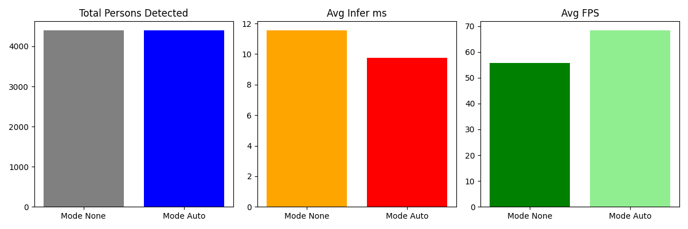
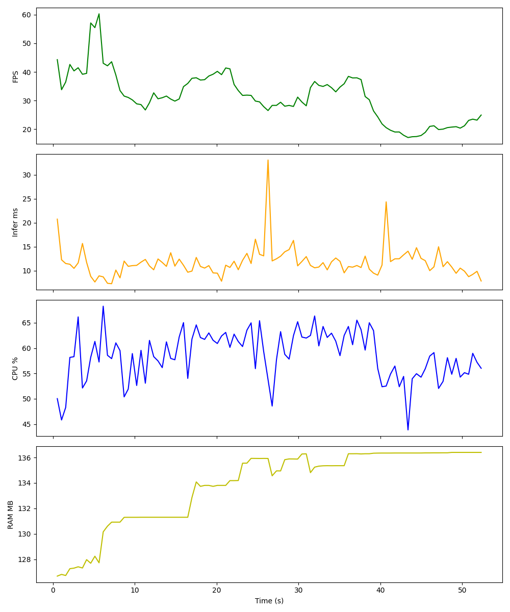

# Enhanced Person Detection

A computer vision project developed for college coursework that implements real-time person detection with low-light enhancement capabilities. It utilizes a pre-trained YOLOX-based lightweight person detection model obtained from the internet, running efficiently on CPUs.

## Setup
### Requirements
- Python 3.8+
- OpenCV (`cv2`)
- NumPy
- `psutil`
- `matplotlib` (Optional, used for generating resource usage graphs)
- ONNX Runtime (`onnxruntime` or `onnxruntime-gpu`)

```powershell
pip install opencv-python numpy psutil matplotlib onnxruntime
```

## Running the Application
To run the live detection app with your primary webcam (ID 0):
```powershell
python app.py --camera 0
```

To run it on a video file:
```powershell
python app.py --video test.mp4
```

### CLI Arguments
- `--camera`: The ID of your webcam (default: `0`).
- `--video`: Path to a video file. If provided, overrides the webcam.
- `--model`: Path to the ONNX model file (default: `model/model.onnx`).
- `--mode`: Initial enhancement mode. Options: `none`, `gamma`, `clahe`, `hist`, `auto`. (default: `auto`).
- `--width`, `--height`: Display and processing resolution (default: `640x360`).

### Key Controls
- **`e`**: Cycle through enhancement modes.
- **`v`**: Cycle the "Analysis View" window (Off -> Sobel -> Canny -> LBP).
- **`g`**: Toggle the resource graph dashboard on/off.
- **`ESC`**: Quit the application and save the usage report.

### Testing and Benchmarking
Run the low-light comparison test on a video:
```powershell
python compare_lowlight.py --video test.mp4
```

### Outputs
Below is a comparison of detection performance on a sample video, showcasing the impact of the automated enhancement pipeline:


Sample resource usage report from running the live application:



## Project Structure
- `detector.py`: Person detection module handling ONNX inference (using a YOLOX lightweight model from the web).
- `model/`: Folder containing the pre-trained ONNX model files.
- `enhance.py`: Provides image transformations (negative, log, gamma, equalize, CLAHE, low-light fix) and edge detection functions (Sobel, Canny, vectorized LBP).
- `monitor.py`: Real-time system resource monitor (CPU, RAM, FPS, Inference time) that outputs a plotted CV2 image and CSV/PNG reports.
- `app.py`: The main program loop integrating the camera input, enhancements, object detection, and resource monitoring dashboard.
- `compare_lowlight.py`: Benchmark script comparing detection results with and without enhancement on a video.
